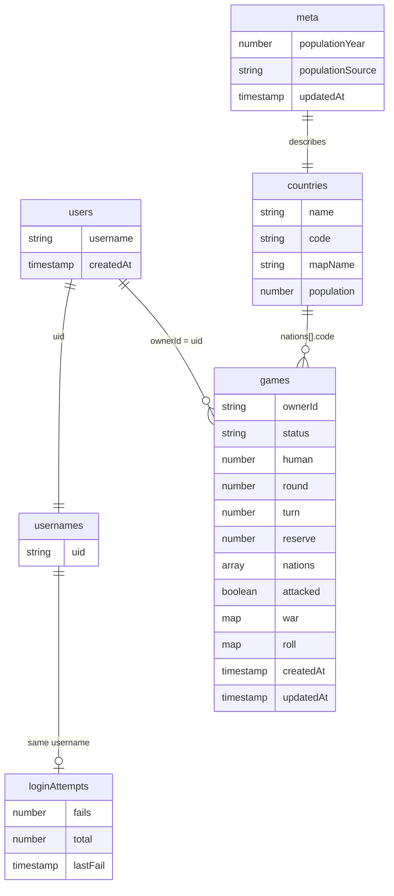

# Geopolitics 101

Single player geopolitics game. Play against 9 NPS and try to be the conquerer of all 10 countries, including yours.

- **Play:** [geopolitics-game-xi.vercel.app](https://geopolitics-game-xi.vercel.app)
- **Demo video:** _add link_

## Try it

- **Sign up:** open the game, choose Sign up, and create an account with your email, a username and a password
- **Demo login:**
  - Username: `examiner`
  - Password: `examiner-2026-bulle!`

## Running it locally

### Prerequisites

- Node.js 24.12 or newer, which comes with npm: [nodejs.org](https://nodejs.org)
- Vercel CLI

  ```bash
  npm install -g vercel
  ```

### Installation

1. Get a free API key at [console.groq.com](https://console.groq.com)
2. Get a Firebase service account key: Firebase console → Project settings → Service accounts → Generate new private key
3. Clone the repo

   ```bash
   git clone https://github.com/zowhere/geopolitics-game.git
   ```

4. Install npm packages

   ```bash
   cd geopolitics-game/client
   npm install
   ```

5. Enter your keys in `client/.env.local`

   ```
   GROQ_API_KEY= enter your Groq Key
   FIREBASE_SERVICE_ACCOUNT= enter service account key
   ```

   **Getting the service account key** (examiners, or any account with access to the Firebase project):
   1. Go to the [Firebase console](https://console.firebase.google.com/) and sign in with the account that has access.
   2. Open **geopolitics-game-b9b31**.
   3. Click the gear icon → **Project settings** → **Service accounts** → **Firebase Admin SDK** → **Generate new private key**. A `.json` file downloads.
   4. Open the file, copy all of it onto one line, and paste it after `FIREBASE_SERVICE_ACCOUNT=` in `client/.env.local`.

6. Start the game and its server, then open [localhost:3000](http://localhost:3000)

   ```bash
   vercel dev
   ```

## Database seperate to rest of application

Game uses Firebase for storage so the database is hosted separately on Google's cloud infrastructure.

The database classes found in [client/src/db](client/src/db) listed below, use Firebase SDK to send requests over the internet and Firebase answers, dependent on security rules.

- [AccountStore.ts](client/src/db/AccountStore.ts)
- [CountryStore.ts](client/src/db/CountryStore.ts)
- [firebase.ts](client/src/db/firebase.ts)
- [GameStore.ts](client/src/db/GameStore.ts)

I used Firebase Cloud Firestore, the online NoSQL database, because its document-based structure is flexible and suited my game data.

My game uses Firebase Cloud Firestore (NoSQL) with one database (`default`) containing five collections:

| Collection  | Documents                                          |                                  |
| ----------- | -------------------------------------------------- | -------------------------------- |
| `countries` | 234 documents, one per country.                    | this will likely remain the same |
| `games`     | 21 documents, one per saved game.n                 | this will grow dynamically       |
| `meta`      | 1 document storing the source of the country data. | this will likely remain the same |
| `usernames` | 12 documents, one per username.                    | this will grow                   |
| `users`     | 12 documents, one per player.                      | this will grow                   |

**note:** it uses collection → document → fields. I am able to add multiple field

An example collection in my database (named `(default)`):

```
collection: usernames
document:   zoe
field:      uid: "zoe's account ID"
```

### Benefits

- It uses Google-hosted infrastructure so my databases scale automatically reducing the administration of maintaining my owner server. With Firebase, the google server comes with patches and data is online most of the time.
- Firebase has real-time listeners (`onSnapshot`), which were beneficial for my shared-link live watching feature, where players share their game with viewers.
- Firebase comes with Authentication and providd secure sign-up, login, password reset and session tokens and it stores passwords only as salted hashes.
- It includes Firestore Security Rules which let me set rules such as: a game can only be updated by the signed-in player whose ID matches its `ownerId`, however anyone can watch it. This was important for ensuring viewers do no interfere with game play.

- Firebase provides a Web SDK allowing my game to communicate directly and securely with Firestore from the browser. It removes the need for me to build a separate database API or manage a database server. This reduced my project size (code-wise) and saves me money, as I did not have to invest in infrastructure upfront. As the number of users playing the game grows, it will scale dynamically until I reach my free-plan limits.
- I used Firebase's free Spark plan because it covered the game's data needs at no cost. It allowed me to build the game and have a few users test it.
- It also has Firebase Analytics which i have not set up at the moment but in the future I plan to and it will help me see analytics related to Reach, game Engagement and custom events such as Tracking how many game invitation links are shared and how many of those links are clicked, helping me measure word-of-mouth growth.

## Databse Configuration

**Platform:** Firebase Cloud Firestore, an online NoSQL document database hosted on Google's cloud, on the free Spark plan.

**Structure:** one database (`default`) with five collections: `countries`, `games`, `meta`, `usernames`, `users`.

**Data organisation:** documents with key-value fields.

- Each saved game is one document holding the board, soldiers, turn, round and status.
- Each account is one document in `users`, holding the username and when it was created. Its ID matches the player's login ID.
- Each username is one document in `usernames`, named after the username the player chose, and holding the player's ID, ensuring no duplication.
- Each country is one document in `countries`, named by country code and holding the name, map name and population.
- The data source is one document in `meta`, holding where the population figures came from and which year.

**Security:** Firebase Authentication and Firestore Security Rules.

**Configuration files:**

- [firestore.rules](firestore.rules) (access)
- [firestore.indexes.json](firestore.indexes.json) (fast game lists)
- [firebase.json](firebase.json) links the rules and indexes, deployed with the Firebase CLI

Countries were loaded with a [seed script](client/scripts/seed-countries.mjs).

**Integration:** Firebase Web SDK, in [client/src/db](client/src/db), connects the browser directly to [Firestore](https://console.firebase.google.com/project/geopolitics-game-b9b31/firestore) with no separate server.

## Database Connection

The game connects to Firestore in [firebase.ts](client/src/db/firebase.ts).

## Design of the database

- The application uses a Singleton pattern by creating one Firebase app instance and one Firestore database instance in [firebase.ts](client/src/db/firebase.ts).
- These instances are exported and reused throughout the application. I don't make new connections in individual files, which avoids unnecessary initialisation and ensures centralised access to the database.
- The application follows MVC by separating the Model ([src/game](client/src/game) and [src/db](client/src/db)), View ([src/screens](client/src/screens) and [src/components](client/src/components)) and Controller ([src/hooks](client/src/hooks) and [App.tsx](client/src/App.tsx)).
- The Model handles game logic and database operations, while the View handles the user interface and the Controller coordinates interactions.
- This separates database access from the presentation layer and database changes can be made without requiring changes to the UI.

## Coding Structure

### 1. Classes and Objects

I used classes to structure the application into reusable components. These include game classes ([Game](client/src/game/Game.ts), [Territory](client/src/game/Territory.ts), [Battle](client/src/game/Battle.ts), [Player](client/src/game/Player.ts), [HumanPlayer](client/src/game/HumanPlayer.ts), [NpcPlayer](client/src/game/NpcPlayer.ts), [NpcStrategy](client/src/game/NpcStrategy.ts) and [Commentator](client/src/game/Commentator.ts)), database classes ([AccountStore](client/src/db/AccountStore.ts), [CountryStore](client/src/db/CountryStore.ts) and [GameStore](client/src/db/GameStore.ts)) and server classes ([AccountService](client/api/account.ts) and [GroqCommentator](client/api/commentary.ts)).

Objects are instantiated from these classes. For example, when a new game is created, [Game](client/src/game/Game.ts) creates a [Territory](client/src/game/Territory.ts) and a player for each country. A new game is started through [App.tsx](client/src/App.tsx). When a user starts a game, they are represented by a new [HumanPlayer](client/src/game/HumanPlayer.ts) object, and each of the 9 rival countries becomes a new [NpcPlayer](client/src/game/NpcPlayer.ts) object.

### 2. Encapsulation

- I used encapsulation to protect internal data and control how it is accessed or modified.
- In [Territory.ts](client/src/game/Territory.ts), `ownerIndex` and `soldierCount` are private and can only be modified through methods such as `addSoldiers()`, `loseSoldiers()` and `moveSoldiersTo()`. These methods enforce game rules, such as ensuring every country retains at least one soldier.
- In [Game.ts](client/src/game/Game.ts), properties such as `round`, `turn`, `reserve` and war state are private and accessed through getters. The private constructor also ensures games are created through `Game.start()` or `Game.restore()`.

### 3. Inheritance and Polymorphism

- I used inheritance through an abstract [Player](client/src/game/Player.ts) class, which provides shared functionality and defines methods such as `takeTurn()` and `fortify()`.
- [HumanPlayer](client/src/game/HumanPlayer.ts) and [NpcPlayer](client/src/game/NpcPlayer.ts) inherit from `Player` and implement their own versions of these methods. Different player types can use the same method interface and perform different actions.

## Screenshots

**Game screenshots:** _add_

| Laptop | iPhone 15 | Samsung |
| ------ | --------- | ------- |
| _add_  | _add_     | _add_   |

## Features

### From the brief

**Game logic**

- [x] Single player against 9 NPCs, 10 countries in total
- [x] Pick your country from the full list; the other 9 are chosen at random
- [x] Soldiers based on population, using the brief's table
- [x] Random first player
- [x] Several saved games; continue whichever you want

**Turns**

- [x] Attack once per turn or skip
- [x] Transfer soldiers between your countries when no attack is in progress, leaving at least 1 behind
- [x] From round 2, 2 new soldiers per country you hold, placed wherever you like
- [x] Fast-forward through NPC turns while still showing every move
- [x] Eliminated players are skipped; holding all 10 countries wins

**Battles**

- [x] Need at least 2 soldiers to attack; at least 1 always stays behind
- [x] Dice rolled = the smaller army that can fight; dice are paired, higher roll wins, ties lose nothing
- [x] Attack continues until the country falls, you're down to 1 soldier, or you stop
- [x] Conquering gives max(2, value ÷ 2) soldiers, and you choose how many move in
- [x] Stopping an attack ends your attack; you can still transfer, then the turn ends _(see Trade-offs)_
- [x] Every attack, dice roll, loss and outcome is shown as it happens
- [x] AI commentary describes each battle as it unfolds
- [x] All countries and soldier counts stay visible, including the world map during battles

**NPCs**

- [x] Play to win: choose whether to attack, which target and when to stop
- [x] Place reinforcements and transfer soldiers
- [x] Every decision shown with a short reason, also during fast-forward
- [ ] Reason shown when an NPC stops an attack _(in progress)_

**Access**

- [x] Anyone with the link can watch a game
- [x] Only the logged-in owner can play their game
- [x] Anyone can sign up and start their own game

**Technical**

- [x] Web app
- [x] NoSQL database (Firebase Firestore)
- [x] Deployed on Vercel

### Bonus feature: graphics and animations

- Countries drawn as their land shapes with their flags
- Did not use one solid world map as 10/195 countries would be on the battle screen
  rather pieces of land floating on ocean
- Olive helmet soldier counts
- Airdrop plane and parachute crate for new soldiers, dragged onto your countries
- Soldiers marching between countries during transfers
- Rolling dice, falling soldiers and missile strikes in battle
- Stamped results: occupied, failed, retreat
- Your countries glow gold on your turn
- Framed world map of all 10 countries during battles
- Bomb pause button, hover labels and fast-forward

### Extras

- Player analytics
- Live shared-game viewing with a shareable link
- Saves after every move, so a refresh can't replay a roll or a second attack preventing cheating

## How the game works

### Game logic

_turns, dice, reinforcements, conquest, elimination, winning_

### NPC strategy

_how NPCs pick targets, place soldiers, transfer and stop attacking, and how each move is explained_

### AI battle commentary

- Groq, model `openai/gpt-oss-20b`
- Every battle, including fast-forward, gets one line in three parts: attack, defence, result
- The AI only describes the dice; it never changes the result
- If the AI is slow, down or over the limit, the written line shows instead
- _how tokens are saved and the free limits_

## Tech stack

- React, TypeScript, Vite
- Firebase Auth and Firestore
- Vercel (hosting and server endpoints)
- Groq (AI commentary)
- Vitest, oxlint

## Database

Firebase Firestore (NoSQL). All database code lives in `client/src/db`, separate from the game engine and screens.

- **Open the database:** [Firestore console](https://console.firebase.google.com/project/geopolitics-game-b9b31/firestore) ( emails on brief have been given access)
- **Schema:** _add link or diagram_
- **Database screenshots:** _add, e.g._ ``

### Diagram



### Collections

**`countries`**: every country a player can pick. Anyone can read.

- Document ID: country code, e.g. `ke`
- `name`: string
- `code`: string
- `mapName`: string, the name used to draw its shape
- `population`: number, used to work out its soldiers

**`meta`**: information about the country list. Anyone can read.

- Document ID: `countries`
- `populationYear`: number
- `populationSource`: string, the source URL
- `updatedAt`: timestamp

**`users`**: a player's account details. Only that player can read.

- Document ID: Firebase Auth user ID
- `username`: string
- `createdAt`: timestamp

**`usernames`**: keeps usernames unique and links them to a player. Anyone can read; it holds no email.

- Document ID: the username in lowercase
- `uid`: string

**`games`**: saved games. Anyone can read, so shared links work; only the owner can change it.

- Document ID: generated by Firestore
- `ownerId`: string, the owner's user ID
- `status`: string, `waiting`, `playing`, `won` or `lost`
- `human`: number, which of the 10 players is you
- `round`, `turn`, `reserve`: numbers
- `nations`: array of 10, each with `code`, `owner`, `soldiers` and `soldiersLost`
- `attacked`: boolean, whether this turn's attack is used
- `war`: map `{ from, to }` or null, a battle in progress
- `roll`: map or null, the latest dice roll for live watchers
- `createdAt`, `updatedAt`: timestamps

**`loginAttempts`**: failed logins for the lockout. Only the server can read or write.

- Document ID: the username in lowercase
- `fails`: number, wrong passwords in the last 15 minutes
- `total`: number, wrong passwords in a row
- `lastFail`: timestamp

Emails live only in Firebase Auth, never in a collection.

### Sample saved game

Two of the ten nations shown:

```json
{
  "ownerId": "kH2x9QpLm3",
  "status": "playing",
  "human": 3,
  "round": 4,
  "turn": 3,
  "reserve": 0,
  "nations": [
    { "code": "ke", "owner": 3, "soldiers": 7, "soldiersLost": 2 },
    { "code": "eg", "owner": 3, "soldiers": 4, "soldiersLost": 5 }
  ],
  "attacked": true,
  "war": null,
  "roll": null,
  "createdAt": "2026-11-03T18:02:11Z",
  "updatedAt": "2026-11-03T18:24:40Z"
}
```

### Security rules

A player can only read their own account, and a username record can only hold a user ID:

```javascript
match /users/{uid} {
  allow read: if isOwner(uid);
}

match /usernames/{name} {
  allow read: if true;
  allow create: if signedIn()
    && request.resource.data.keys().hasOnly(['uid'])
    && request.resource.data.uid == request.auth.uid;
}
```

The full rules are in [`firestore.rules`](firestore.rules).

### Set up your own database

1. Create a project at [console.firebase.google.com](https://console.firebase.google.com)
2. Turn on **Authentication → Email/Password**
3. Create a **Firestore** database
4. Put your project's web config in `client/src/db/firebase.ts`
5. Install the Firebase CLI, log in and pick your project

   ```bash
   npm install -g firebase-tools
   firebase login
   firebase use --add
   ```

6. Deploy the security rules and indexes, from the repo root

   ```bash
   firebase deploy --only firestore
   ```

7. Load the country list, from `client`

   ```bash
   gcloud auth application-default login
   node scripts/seed-countries.mjs --project=YOUR_PROJECT_ID --confirm
   ```

## Security

- Emails are never stored in public records or sent to the browser
- Username login is checked on the server
- 3 wrong passwords means a 15 minute wait, 10 locks the account
- Firestore rules: players can only read their own account; games can be watched by anyone but only played by the owner
- API keys stay on the server

## Tests

From `client`, run `npm test`.

- **Server rejects invalid battle data:** prevents incorrect or manipulated battle information from reaching Groq
- **Game falls back when Groq fails:** the game keeps working and shows written commentary instead
- **Rate limiter:** the game allows 25 requests per minute and blocks the 26th, preventing excessive API usage
- **Saving and resuming:** a refresh can't replay an attack, and a battle cut off mid-way ends cleanly
- **Account server:** rejects invalid usernames and never sends an email back to the browser

## Trade-offs

### Transfers after stopping an attack

The brief says that stopping an attack ends the turn. In this game, stopping ends the attack, but the player can still transfer soldiers before the turn ends.

Most players stop an attack because they can see their soldier numbers dropping. Their attacking country is then left weak, and an opponent can occupy it in the same round. Letting them move soldiers in to reinforce it first makes the game more competitive and interesting for users.

The game remains fair because once the attack is stopped, the player can't attack again that turn, and NPCs follow the same rules, so they can still win on their own turns.

### Per-move event log

Recording each move as an individual event would enable full replays and allow late spectators to catch up. However, Firebase's free tier is limited to 20,000 writes per day. My current design supports approximately 20 complete games daily, and introducing a per-move event log would reduce this to approximately 10. Therefore, I kept the snapshot-based approach.

## Limitations and known bugs

_add_
