# Geopolitics 101

Single player geopolitics game. Play against 9 NPS and try to be the conquerer of all 10 countries, including yours.

- **Play:** [geopolitics-game-xi.vercel.app](https://geopolitics-game-xi.vercel.app)

## Try it

- **Sign up:** open the game, choose Sign up, and create an account with your email, a username and a password
- **Demo login:**
  - Username: `examiner`
  - Password: `examiner-2026-bulle!`

## Running it locally

### Prerequisites

- Node.js 24.12 or newer, which comes with npm: [nodejs.org](https://nodejs.org)
- Vercel CLI

  ```bash
  npm install -g vercel
  ```

### Installation

1. Get a free API key at [console.groq.com](https://console.groq.com)
2. Get a Firebase service account key: Firebase console → Project settings → Service accounts → Generate new private key
3. Clone the repo

   ```bash
   git clone https://github.com/zowhere/geopolitics-game.git
   ```

4. Install npm packages

   ```bash
   cd geopolitics-game/client
   npm install
   ```

5. Enter your keys in `client/.env.local`

   ```
   GROQ_API_KEY= enter your Groq Key
   FIREBASE_SERVICE_ACCOUNT= enter service account key
   ```

   **Getting the service account key** (examiners, or any account with access to the Firebase project):
   1. Go to the [Firebase console](https://console.firebase.google.com/) and sign in with the account that has access.
   2. Open **geopolitics-game-b9b31**.
   3. Click the gear icon → **Project settings** → **Service accounts** → **Firebase Admin SDK** → **Generate new private key**. A `.json` file downloads.
   4. Open the file, copy all of it onto one line, and paste it after `FIREBASE_SERVICE_ACCOUNT=` in `client/.env.local`.

6. Start the game and its server, then open [localhost:3000](http://localhost:3000)

   ```bash
   vercel dev
   ```

## Database seperate to rest of application

Game uses Firebase for storage so the database is hosted separately on Google's cloud infrastructure.

The database classes found in [client/src/db](client/src/db) listed below, use Firebase SDK to send requests over the internet and Firebase answers, dependent on security rules.

- [AccountStore.ts](client/src/db/AccountStore.ts)
- [CountryStore.ts](client/src/db/CountryStore.ts)
- [firebase.ts](client/src/db/firebase.ts)
- [GameStore.ts](client/src/db/GameStore.ts)

I used Firebase Cloud Firestore, the online NoSQL database, because its document-based structure is flexible and suited my game data.

My game uses Firebase Cloud Firestore (NoSQL) with one database (`default`) containing five collections:

| Collection  | Documents                                          |                                  |
| ----------- | -------------------------------------------------- | -------------------------------- |
| `countries` | 234 documents, one per country.                    | this will likely remain the same |
| `games`     | 21 documents, one per saved game.n                 | this will grow dynamically       |
| `meta`      | 1 document storing the source of the country data. | this will likely remain the same |
| `usernames` | 12 documents, one per username.                    | this will grow                   |
| `users`     | 12 documents, one per player.                      | this will grow                   |

**note:** it uses collection → document → fields. I am able to add multiple field

An example collection in my database (named `(default)`):

```
collection: usernames
document:   zoe
field:      uid: "zoe's account ID"
```

### Benefits

- It uses Google-hosted infrastructure so my databases scale automatically reducing the administration of maintaining my owner server. With Firebase, the google server comes with patches and data is online most of the time.
- Firebase has real-time listeners (`onSnapshot`), which were beneficial for my shared-link live watching feature, where players share their game with viewers.
- Firebase comes with Authentication and providd secure sign-up, login, password reset and session tokens and it stores passwords only as salted hashes.
- It includes Firestore Security Rules which let me set rules such as: a game can only be updated by the signed-in player whose ID matches its `ownerId`, however anyone can watch it. This was important for ensuring viewers do no interfere with game play.

- Firebase provides a Web SDK allowing my game to communicate directly and securely with Firestore from the browser. It removes the need for me to build a separate database API or manage a database server. This reduced my project size (code-wise) and saves me money, as I did not have to invest in infrastructure upfront. As the number of users playing the game grows, it will scale dynamically until I reach my free-plan limits.
- I used Firebase's free Spark plan because it covered the game's data needs at no cost. It allowed me to build the game and have a few users test it.
- It also has Firebase Analytics (not connected currently) which I plan to use in the future to see analytics related to reach, game engagement and custom events such as tracking how many game invitation links are shared and how many of those links are clicked, helping me measure word-of-mouth growth.

## Databse Configuration

**Platform:** Firebase Cloud Firestore, an online NoSQL document database hosted on Google's cloud, on the free Spark plan.

**Structure:** one database (`default`) with five collections: `countries`, `games`, `meta`, `usernames`, `users`.

**Data organisation:** documents with key-value fields.

- Each saved game is one document holding the board, soldiers, turn, round and status.
- Each account is one document in `users`, holding the username and when it was created. Its ID matches the player's login ID.
- Each username is one document in `usernames`, named after the username the player chose, and holding the player's ID, ensuring no duplication.
- Each country is one document in `countries`, named by country code and holding the name, map name and population.
- The data source is one document in `meta`, holding where the population figures came from and which year.

**Security:**

- Firebase Authentication and Firestore Security Rules.
- Emails are never stored in public records or sent to the browser
- Username login is checked on the [server](client/api/account.ts)
- 3 wrong passwords means a 15 minute wait, 10 locks the account
- Firestore rules: players can only read their own account; games can be watched by anyone but only played by the owner
- API keys stay on the [server](client/api)

**Configuration files:**

- [firestore.rules](firestore.rules) (access)
- [firestore.indexes.json](firestore.indexes.json) (fast game lists)
- [firebase.json](firebase.json) links the rules and indexes, deployed with the Firebase CLI

Countries were loaded with a [seed script](client/scripts/seed-countries.mjs).

**Integration:** Firebase Web SDK, in [client/src/db](client/src/db), connects the browser directly to [Firestore](https://console.firebase.google.com/project/geopolitics-game-b9b31/firestore) with no separate server.

## Database Connection

The game connects to Firestore in [firebase.ts](client/src/db/firebase.ts).

## Design of the database

- The application uses a Singleton pattern by creating one Firebase app instance and one Firestore database instance in [firebase.ts](client/src/db/firebase.ts).
- These instances are exported and reused throughout the application. I don't make new connections in individual files, which avoids unnecessary initialisation and ensures centralised access to the database.
- The application follows MVC by separating the Model ([src/game](client/src/game) and [src/db](client/src/db)), View ([src/screens](client/src/screens) and [src/components](client/src/components)) and Controller ([src/hooks](client/src/hooks) and [App.tsx](client/src/App.tsx)).
- The Model handles game logic and database operations, while the View handles the user interface and the Controller coordinates interactions.
- This separates database access from the presentation layer and database changes can be made without requiring changes to the UI.

### Diagram

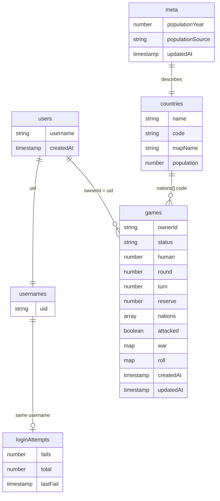

## Coding Structure

### 1. Classes and Objects

I used classes to structure the application into reusable components. These include
game classes ([Game](client/src/game/Game.ts), [Territory](client/src/game/Territory.ts), [Battle](client/src/game/Battle.ts), [Player](client/src/game/Player.ts), [HumanPlayer](client/src/game/HumanPlayer.ts), [NpcPlayer](client/src/game/NpcPlayer.ts), [NpcStrategy](client/src/game/NpcStrategy.ts) and [Commentator](client/src/game/Commentator.ts)),

database classes ([AccountStore](client/src/db/AccountStore.ts), [CountryStore](client/src/db/CountryStore.ts) and [GameStore](client/src/db/GameStore.ts)) and

server classes ([AccountService](client/api/account.ts) and [GroqCommentator](client/api/commentary.ts)).

Objects are instantiated from these classes.

For example, when a new game is created, [Game](client/src/game/Game.ts) creates a [Territory](client/src/game/Territory.ts) and a player for each country.
A new game is started through [App.tsx](client/src/App.tsx).
When a user starts a game, they are represented by a new [HumanPlayer](client/src/game/HumanPlayer.ts) object, and each of the 9 rival countries becomes a new [NpcPlayer](client/src/game/NpcPlayer.ts) object.

### 2. Encapsulation

- I used encapsulation to protect internal data and control how it is accessed or modified.
- In [Territory.ts](client/src/game/Territory.ts), `ownerIndex` and `soldierCount` are private and can only be modified through methods such as `addSoldiers()`, `loseSoldiers()` and `moveSoldiersTo()`.
  These methods enforce game rules like making sure every country retains at least one soldier.
- In [Game.ts](client/src/game/Game.ts), properties such as `round`, `turn`, `reserve` and war state are private and accessed through getters. The private constructor also ensures games are created through `Game.start()` or `Game.restore()`.

### 3. Inheritance and Polymorphism

- I used inheritance through an abstract [Player](client/src/game/Player.ts) class, which provides shared functionality and defines methods such as `takeTurn()` and `fortify()`.
- [HumanPlayer](client/src/game/HumanPlayer.ts) and [NpcPlayer](client/src/game/NpcPlayer.ts) inherit from `Player` and implement their own versions of these methods. Different player types can use the same method interface and perform different actions.

### Coding Practises

I implemented automated tests using Vitest, with five test files covering account management, commentary, fallback behaviour, rate limiting and game saving/restoring. These tests can be executed using `npm test`.

- [account.test.ts](client/tests/account.test.ts)
- [commentary.test.ts](client/tests/commentary.test.ts)
- [fallback.test.ts](client/tests/fallback.test.ts)
- [rateLimiter.test.ts](client/tests/rateLimiter.test.ts)
- [saveRestore.test.ts](client/tests/saveRestore.test.ts)

I separated functionality into classes, each with a clear responsibility, so that each function, method or class performs a single, well-defined task.

For example, [Battle](client/src/game/Battle.ts) handles battle calculations, [Territory](client/src/game/Territory.ts) manages individual country state, and [GameStore](client/src/db/GameStore.ts) handles game persistence.

The same applies to methods: in [Territory](client/src/game/Territory.ts), `addSoldiers()` only adds soldiers, `loseSoldiers()` only removes them, and `moveSoldiersTo()` only moves them between countries. This makes the code easier to maintain and modify.

## Data Validation, Controls & Security

Implemented input validation at three levels: client-side form validation ([LoginScreen.tsx](client/src/screens/LoginScreen.tsx)), server-side API validation ([api/account.ts](client/api/account.ts)) and Firestore Security Rules ([firestore.rules](firestore.rules)), providing protection against invalid or unauthorised data.

- Implemented Firestore Security Rules ([firestore.rules](firestore.rules)) to ensure players only modify their own data and read their own profile while anyone can watch a shared game.
- Initially, player emails were stored alongside usernames, meaning other users could potentially access them.
- fixed by storing only the player ID in the `usernames` collection and moving login (user based login)to a Vercel serverless function ([api/account.ts](client/api/account.ts)), which looks up the email privately through Firebase Authentication which keeps email addresses private.
- Implemented rate limiting ([BattleCommentary.ts](client/src/ai/BattleCommentary.ts)) to restrict AI commentary requests to 25 per minute. This prevents excessive API calls and control usage of the external Groq AI service, as I am using a free tier that has limits.
- Groq limits for openai/gpt-oss-20b:

- 30 requests a minute. The game is capped at 25 ([BattleCommentary.ts](client/src/ai/BattleCommentary.ts#L11)).
- 1,000 requests a day.
- 8,000 tokens a minute.

## AI Application

- Groq API (openai/gpt-oss-20b) generates battle commentary that describes battle events as they take place.
  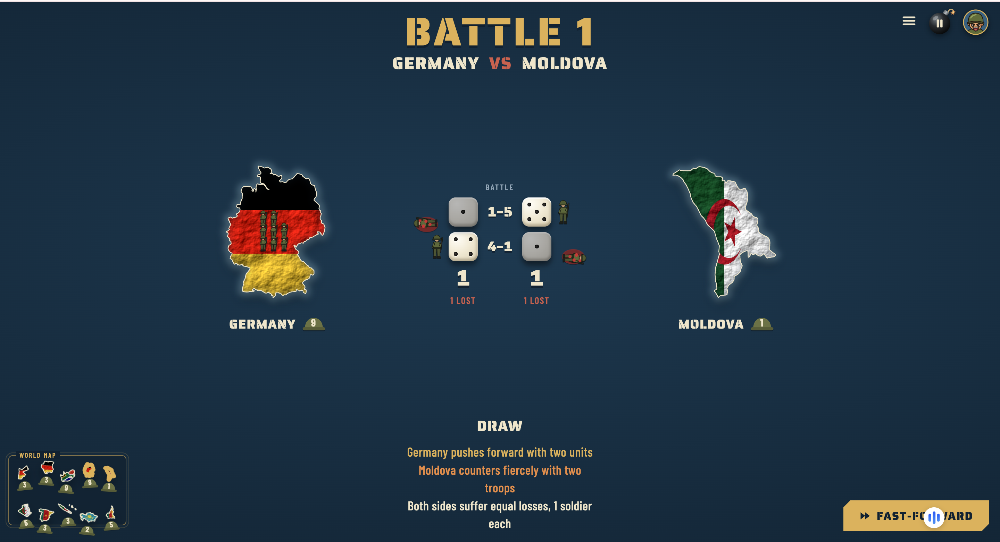
  Above is example of AI generated battle commenatry

- [api/commentary.ts](client/api/commentary.ts) handles requests and keeps the Groq API key secure on the server.
- The LLM is instructed in [api/commentary.ts](client/api/commentary.ts) to use only the supplied battle facts, without inventing events or repeating dice values.
- AI then generates three short commentary phrases, which are validated in [api/commentary.ts](client/api/commentary.ts) and [BattleCommentary.ts](client/src/ai/BattleCommentary.ts) before display.
- [Commentator.ts](client/src/game/Commentator.ts) provides commentary if the AI request times out, fails or reaches its rate limit.
- Responses are limited to 300 tokens and use low reasoning effort in [api/commentary.ts](client/api/commentary.ts) to control API usage.
- The AI only generates commentary; it does not determine dice rolls, battle outcomes or NPC decisions. Dice and outcomes are controlled by [Battle.ts](client/src/game/Battle.ts) and [Game.ts](client/src/game/Game.ts), and NPC decisions by [NpcStrategy.ts](client/src/game/NpcStrategy.ts).

## Functionality

Implemented a `useLoadedImage` hook ([useLoadedImage.ts](client/src/hooks/useLoadedImage.ts)), used in [Island.tsx](client/src/components/Island.tsx), to manage flag images displayed on the map.

- It waits for flag images to finish loading before displaying them, preventing flickering or partially loaded images.
  It has a shared set of loaded flags so previously downloaded images can be reused and displayed immediately without loading them again.
  This makes the game look cohesive.

- Priority queue implemented as a binary max-heap ([PriorityQueue.ts](client/src/utils/PriorityQueue.ts)). In [NpcStrategy.ts](client/src/game/NpcStrategy.ts), every valid attack an NPC could make is pushed onto the heap, ordered by `isBetterOption` that ranks by soldier advantage, with the weakest defender as the tie-break. `pop()` returns the highest-priority attack first, allowing the NPC to choose its best move without sorting the entire list.

## Ease of navigation

- On each page there's button that guides players on what to do next e.g log in, next, play, pause, fast forward
- New players are shown an interactive how-to-play and a demo
- The how to play remains in the settings and users can go over it again, at any given time
- Unfinished games show as flag badges on the menu allowing players to resume
- Security – authentication & authorization  
  Sophistication & Complexity – Battle engine, game engine, AI integration, access control etc.
- The layout looks very similar on different screens. I tested on Mac laptop, Iphone 16, Iphone SE, Samsung Galaxy, Redmi Tablet

## User Interface

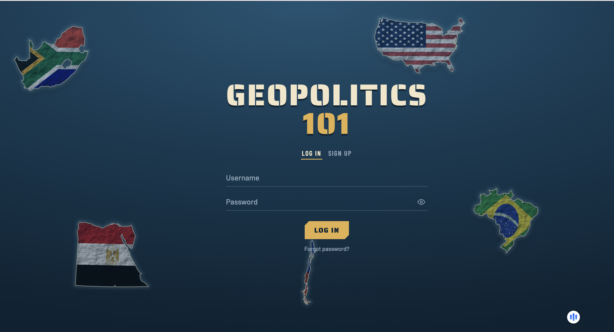 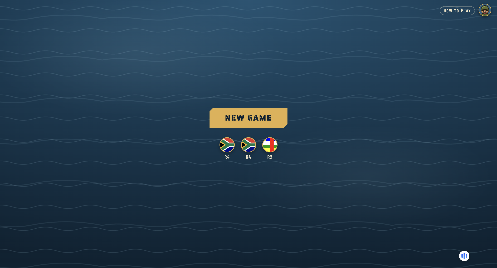
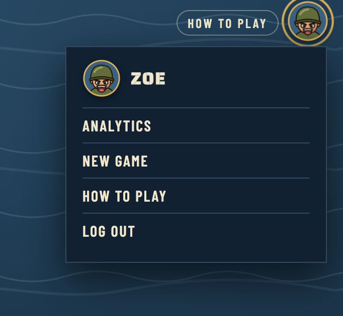 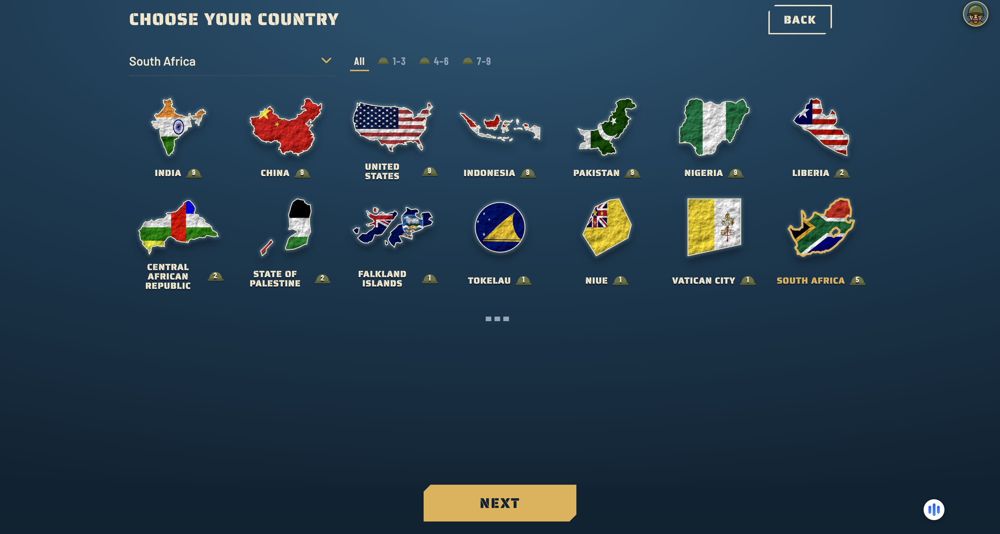
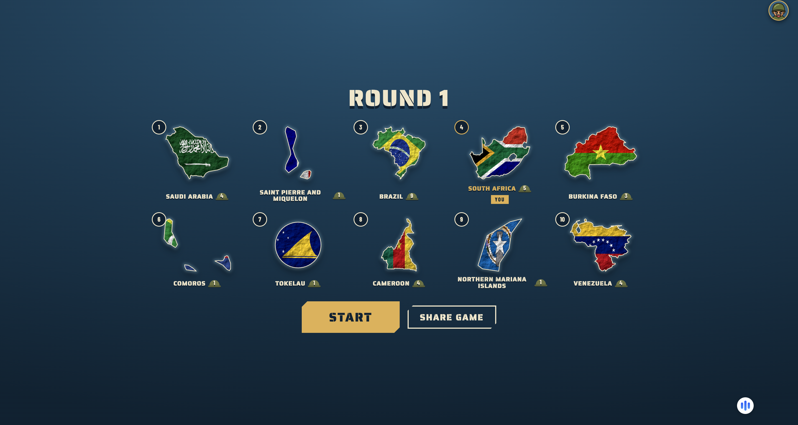 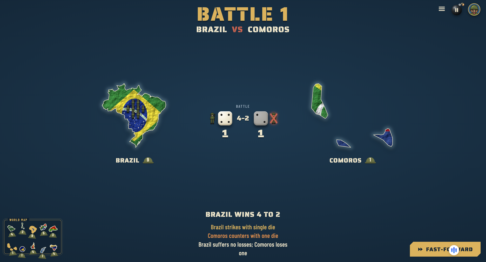
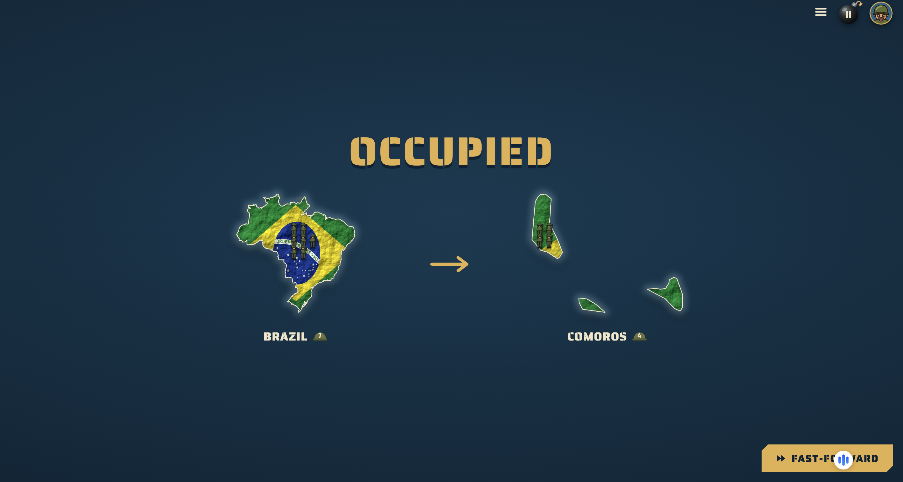 
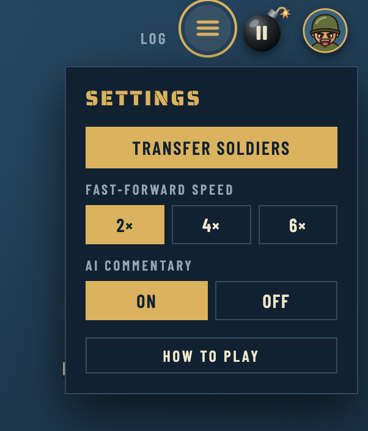

| Laptop                                                       | iPhone 16                                                        | Samsung                                                        |
| ------------------------------------------------------------ | ---------------------------------------------------------------- | -------------------------------------------------------------- |
|  |  | 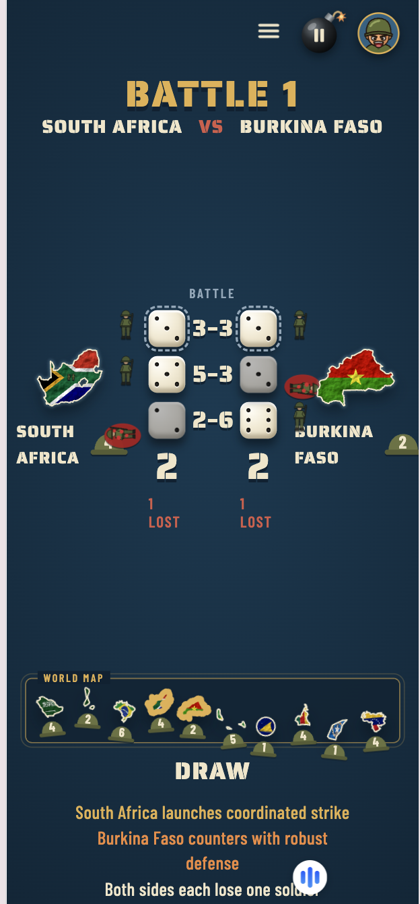 |

## Bonus feature: graphics and animations

- Countries drawn as their land shapes with their flags
- I didn't use a full world map, because only 10 countries are in each game. Instead, each country floats as its own piece of land on the ocean
- Olive helmet soldier counts
- I used a retro-looking theme and used colours that work well together and are easy on user's eyes
- Main colours used in the game:
  - `#0b2232` deep navy (darkest sea)
  - `#133a52` ocean blue
  - `#1f5574` lighter sea blue
  - `#9fd0e0` foam (wave lines)
  - `#e3b04b` yellow main buttons, your country
  - `#f1e6c8` cream white headings
- Some icons used:
  - Bomb pause button with fuse and spark ([BoardScreen.tsx](client/src/screens/BoardScreen.tsx))
  - Cartoon soldier avatar for the profile ([ProfileMenu.tsx](client/src/components/ProfileMenu.tsx))
  - Army helmets next to soldier counts ([Helmet.tsx](client/src/components/Helmet.tsx))
  - Airdrop crate for reinforcements ([ReserveBox.tsx](client/src/components/ReserveBox.tsx))
  - Missiles ([MissileStrike.tsx](client/src/components/MissileStrike.tsx))

- Airdrop plane and parachute crate for new soldiers, dragged onto your countries
- Soldiers marching between countries during transfers
- Rolling dice, falling soldiers and missile strikes in battle
- Stamped results: occupied, failed, retreat
- Your countries glow yellow on Single Player Turn, so it easily stands out
- Framed world map of all 10 countries during battles
- Bomb pause button, hover labels and fast-forward

- The how-to-play also uses animations

## Game logic

- Single player against 9 NPCs, 10 countries in total
- Pick your country from the full list; the other 9 are chosen at random
- Soldiers based on population, using the brief's table
- Random first player
- Several saved game continue whichever you want

**Turns**

- Attack once per turn or skip
- Transfer soldiers between your countries when no attack is in progress, leaving at least 1 behind
- From round 2, 2 new soldiers per country you hold, placed wherever you like
- Fast-forward through NPC turns while still showing every move
- Eliminated players are skipped; holding all 10 countries wins

**Battles**

- Need at least 2 soldiers to attack; at least 1 always stays behind
- number of dice rolled is = to the smaller army that can fight.
- dice are paired, higher roll wins, ties lose nothing
- Each die roll you lose, a soldier dies
- Attack continues until the country falls, you're down to 1 soldier, or you stop
- Conquering gives max(2, value ÷ 2) soldiers, and you choose how many move in to your new conquered country
- Stopping an attack ends your attack; you can still transfer, then the turn ends

- Every attack, dice roll, loss and outcome is shown as it happens
- AI commentary describes each battle as it happens
- All countries and soldier counts stay visible, including the world map during battles

**NPCs**
These are computer-controlled players that make their own decisions during the game using the NpcStrategy.ts class.
They play to win and choose whether to attack, which target and when to stop
They can Place reinforcements and transfer soldiers
They show very decision shown with a short reason, also during fast-forward

**Access**

- Anyone with the link can watch a game
- Only the logged-in owner can play their game
- Anyone can sign up and start their own game

## Tech Stack

- **Frontend:** React, TypeScript 7, Vite
- **Backend:** Node.js, Vercel Serverless Functions
- **Database:** Firebase Cloud Firestore, Firebase Authentication, Firebase Web SDK 13
- **AI:** Groq API (openai/gpt-oss-20b)
- **Hosting:** Vercel
- **Testing:** Vitest

### Extras

- Player analytics 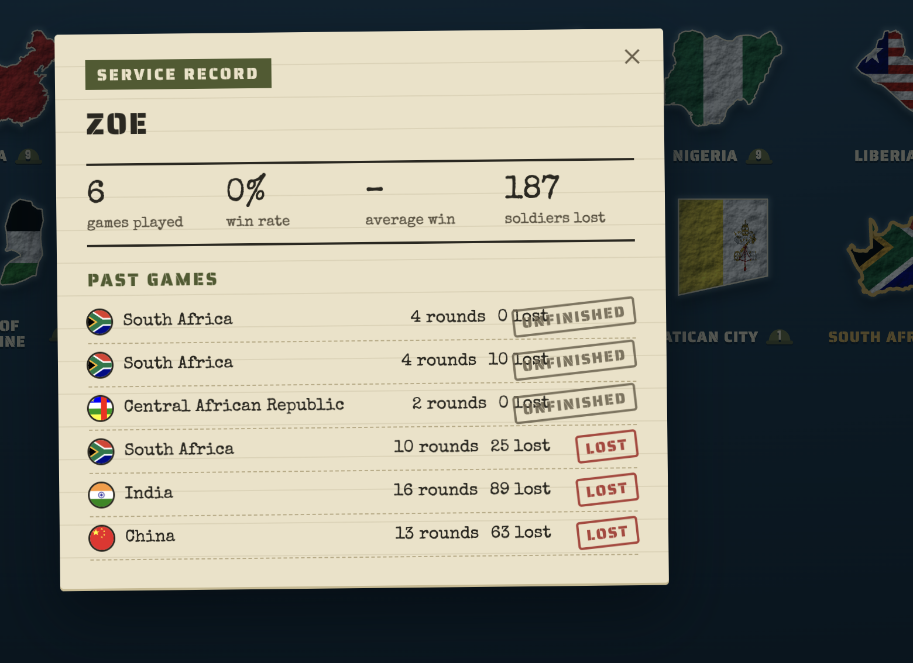
- Live shared-game viewing with a shareable link
- Saves after every move, so a refresh can't replay a roll or a second attack preventing cheating

### NPC strategy

### Security rules

A player can only read their own account, and a username record can only hold a user ID:

```javascript
match /users/{uid} {
  allow read: if isOwner(uid);
}

match /usernames/{name} {
  allow read: if true;
  allow create: if signedIn()
    && request.resource.data.keys().hasOnly(['uid'])
    && request.resource.data.uid == request.auth.uid;
}
```

The full rules are in [`firestore.rules`](firestore.rules).

### Set up your own database

1. Create a project at [console.firebase.google.com](https://console.firebase.google.com)
2. Turn on **Authentication → Email/Password**
3. Create a **Firestore** database
4. Put your project's web config in `client/src/db/firebase.ts`
5. Install the Firebase CLI, log in and pick your project

   ```bash
   npm install -g firebase-tools
   firebase login
   firebase use --add
   ```

6. Deploy the security rules and indexes, from the repo root

   ```bash
   firebase deploy --only firestore
   ```

7. Load the country list, from `client`

   ```bash
   gcloud auth application-default login
   node scripts/seed-countries.mjs --project=YOUR_PROJECT_ID --confirm
   ```

## Trade-offs

### Transfers after stopping an attack

Stopping an attack should immediately end the turn but in this game, stopping ends the attack, but the player can still transfer soldiers before the turn ends.

Most players stop an attack because they can see their soldier numbers dropping. Their attacking country is then left weak, and an opponent can occupy it in the same round. Letting them move soldiers in to reinforce it first makes the game more competitive and interesting for users.

The game remains fair because once the attack is stopped, the player can't attack again that turn, and NPCs follow the same rules, so they can still win on their own turns. The attack still ends. Just not the turn.

### Per-move event log

Recording each move as an individual event would enable full replays. However, Firebase's free tier is limited to 20,000 writes per day. My current design supports about 20 complete games daily, and introducing a per-move event log would reduce this drastically. To have more people play the game whilst I use the free tier, I used the snapshot-based approach ([Game.ts](client/src/game/Game.ts#L132), [GameStore.ts](client/src/db/GameStore.ts#L61)).

## Limitations and known bugs
